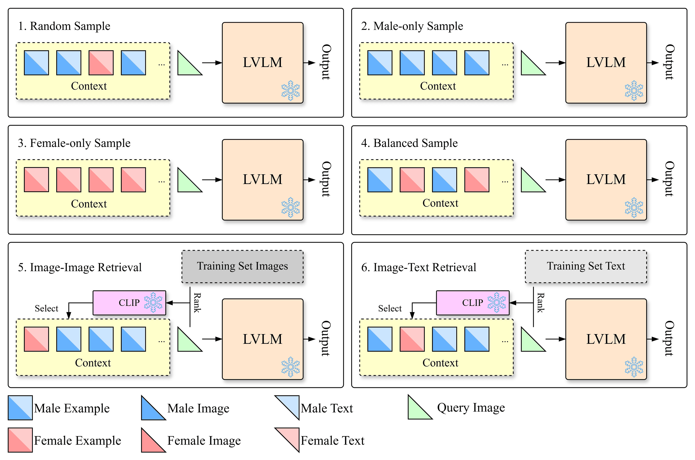

# Gender Bias in Vision-Language In-Context Learning

This repository is the official implementation of the ECCV 2026 paper *Gender Bias in Vision-Language In-Context Learning*.

[](https://arxiv.org/abs/2609.27682)

<p align="center">
  
</p>

## Abstract

In-context learning (ICL) enables large vision-language models (LVLMs) to perform tasks by following patterns from in-context examples, yet its potential to amplify societal biases remains underexplored. We systematically investigate how ICL influences gender bias in LVLMs through **VL-BICLE**, an evaluation framework comprising six ICL settings, three tasks, and four datasets. Our experiments on six LVLMs reveal that gendered ICL demonstrations act as a directional force, shifting model bias toward the demonstrated gender through a cross-gender mechanism that disproportionately degrades performance on the opposite gender. This effect appears in image captioning and pronoun prediction but not in visual question answering, indicating that gendered ICL influences bias only when the task output involves gendered language. Similarity-based retrieval methods inherit the training pool's gender imbalance and offer no debiasing advantage, while standard quality metrics remain blind to these bias shifts. To mitigate this bias, we replace real in-context images with synthetic ones from stable diffusion models while keeping captions unchanged. This simple intervention reduces gender bias without degrading caption quality.

## Framework

VL-BICLE builds the in-context examples of a query with one of six ICL settings:

| Setting                                | Abbreviation | In-context examples                                    |
| -------------------------------------- | ------------ | ------------------------------------------------------ |
| Random Sample                          | RS           | uniform sample from the training pool                  |
| Male-only Sample                       | MS           | male-presenting examples only                          |
| Female-only Sample                     | FS           | female-presenting examples only                        |
| Balanced Sample                        | BS           | equal male and female examples, interleaved            |
| Similarity-based Image-Image Retrieval | SIIR         | top-k training examples by CLIP image-image similarity |
| Similarity-based Image-Text Retrieval  | SITR         | top-k training examples by CLIP image-text similarity  |

The settings are applied to three tasks: image captioning (COCOBias and DCI), pronoun prediction (VisoGender), and visual question answering (VQA, VisualCoT). SIIR and SITR run on COCOBias only. VQA runs on three of the six models (MiniCPM-o 2.6, Phi-3.5-vision-instruct, and Qwen3-VL-8B-Instruct). The bias mitigation experiment replaces the real COCOBias in-context images with images generated by FLUX.1-dev or Stable Diffusion 3.5 Large (SD35L) from the same captions.

## Evaluated models

| Model                   | Weights                                                  |
| ----------------------- | -------------------------------------------------------- |
| Qwen-VL                 | https://huggingface.co/Qwen/Qwen-VL                      |
| MiniCPM-o 2.6           | https://huggingface.co/openbmb/MiniCPM-o-2_6             |
| Phi-3.5-vision-instruct | https://huggingface.co/microsoft/Phi-3.5-vision-instruct |
| Idefics3-8B-Llama3      | https://huggingface.co/HuggingFaceM4/Idefics3-8B-Llama3  |
| InternVL3.5-8B          | https://huggingface.co/OpenGVLab/InternVL3_5-8B          |
| Qwen3-VL-8B-Instruct    | https://huggingface.co/Qwen/Qwen3-VL-8B-Instruct         |

[doc/models.md](doc/models.md) lists the CLI keys, download commands, and the auxiliary models (the GPT-OSS-20B judge, FLUX.1-dev, SD35L, and CLIP ViT-B/32).

## Datasets

| Dataset    | Task               | Source                                               |
| ---------- | ------------------ | ---------------------------------------------------- |
| COCOBias   | image captioning   | MS-COCO 2014 with the Zhao et al. gender annotations |
| DCI        | image captioning   | Densely Captioned Images (SA-1B photos)              |
| VisoGender | pronoun prediction | VisoGender OO and OP annotations                     |
| VisualCoT  | VQA                | GQA subset of Visual-CoT                             |

[doc/datasets.md](doc/datasets.md) gives the split sizes, the download links, and the build commands.

## Getting started

1. [doc/installation.md](doc/installation.md): create the conda environments (two mutually incompatible model environments and an optional diffusion environment).
2. [doc/models.md](doc/models.md): download the six LVLMs and the auxiliary models.
3. [doc/datasets.md](doc/datasets.md): download the public sources and build the four datasets.
4. [doc/experiments.md](doc/experiments.md): run inference, evaluation, and summary aggregation.

## Repository structure

```
├── src/
│   ├── data/            # datasets
│   ├── model/           # model wrappers
│   ├── sampling/        # ICL settings
│   ├── inference/       # inference drivers
│   ├── evaluation/      # evaluation and summaries
│   └── metric/          # metrics
├── utils/               # helper scripts
├── doc/                 # documentation
├── data/                # datasets
├── models/              # model weights
├── results/             # per-run outputs
├── summary/             # aggregated summaries
└── requirements-*.txt   # one file per environment
```

## License

The code is released under the [MIT License](LICENSE).

## Citation

```bibtex
@article{xiang2026gender,
  title   = {Gender Bias in Vision-Language In-Context Learning},
  author  = {Tong Xiang and Yuta Nakashima and Noa Garcia},
  journal = {arXiv preprint arXiv:2609.27682},
  year    = {2026},
}
```
